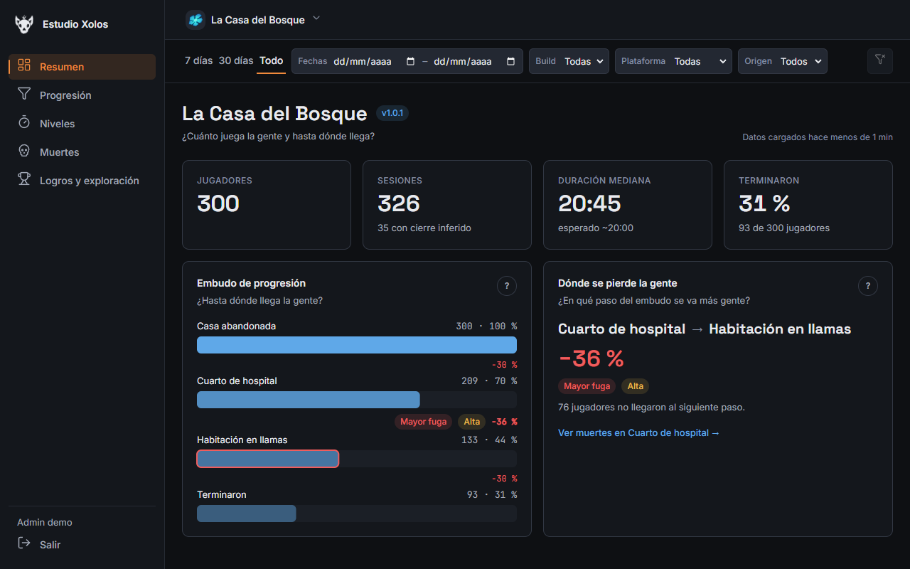
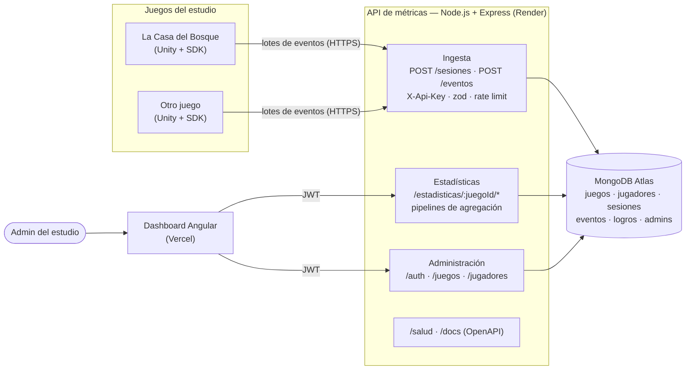
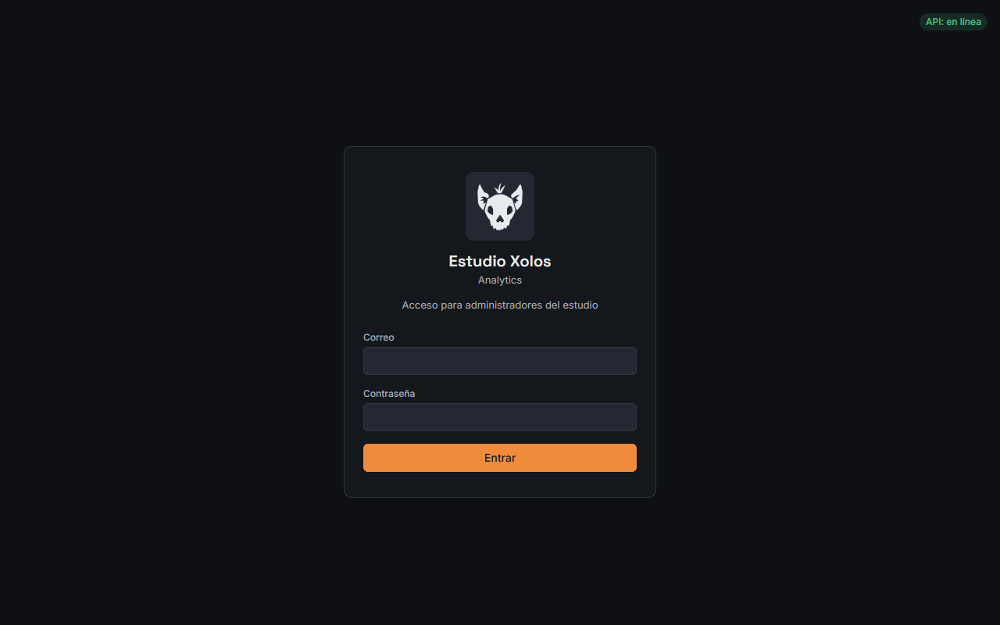
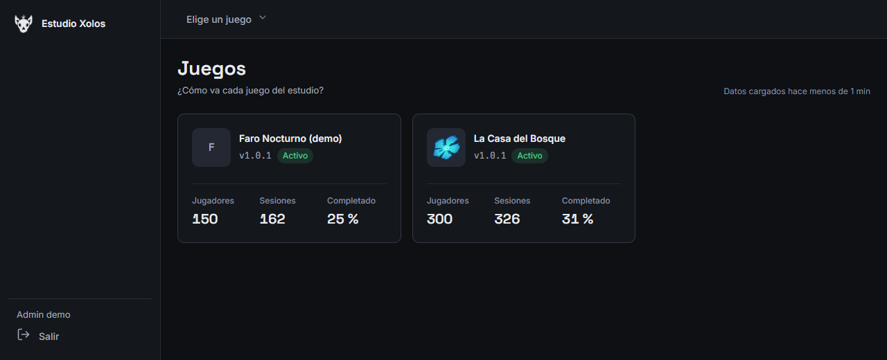
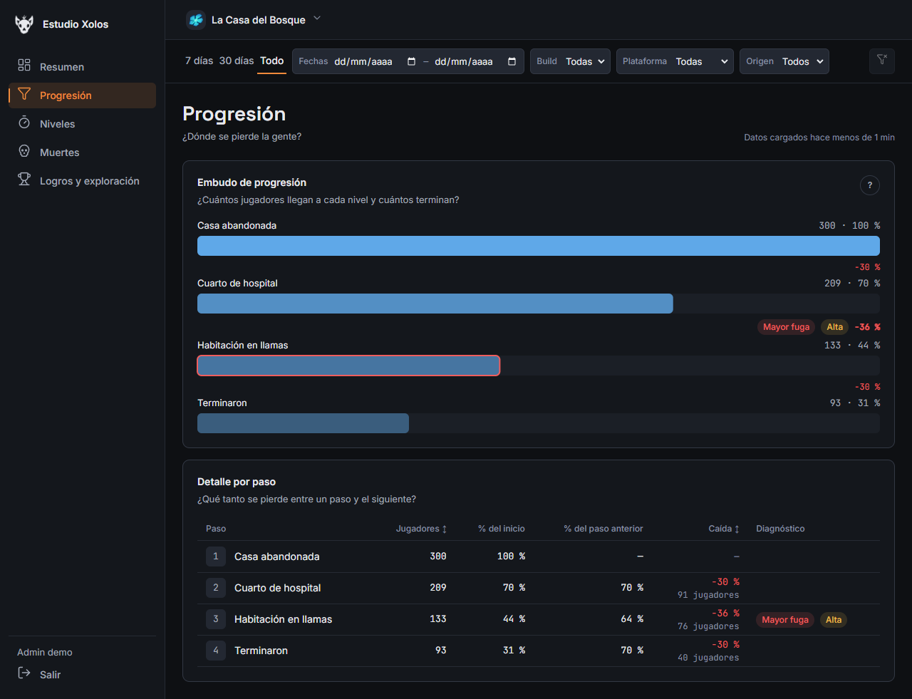
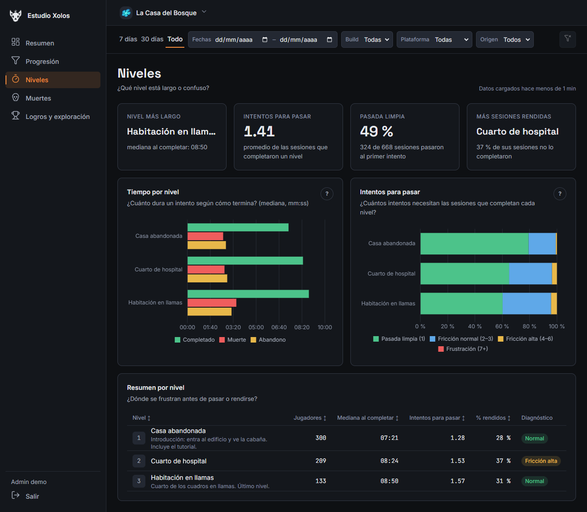
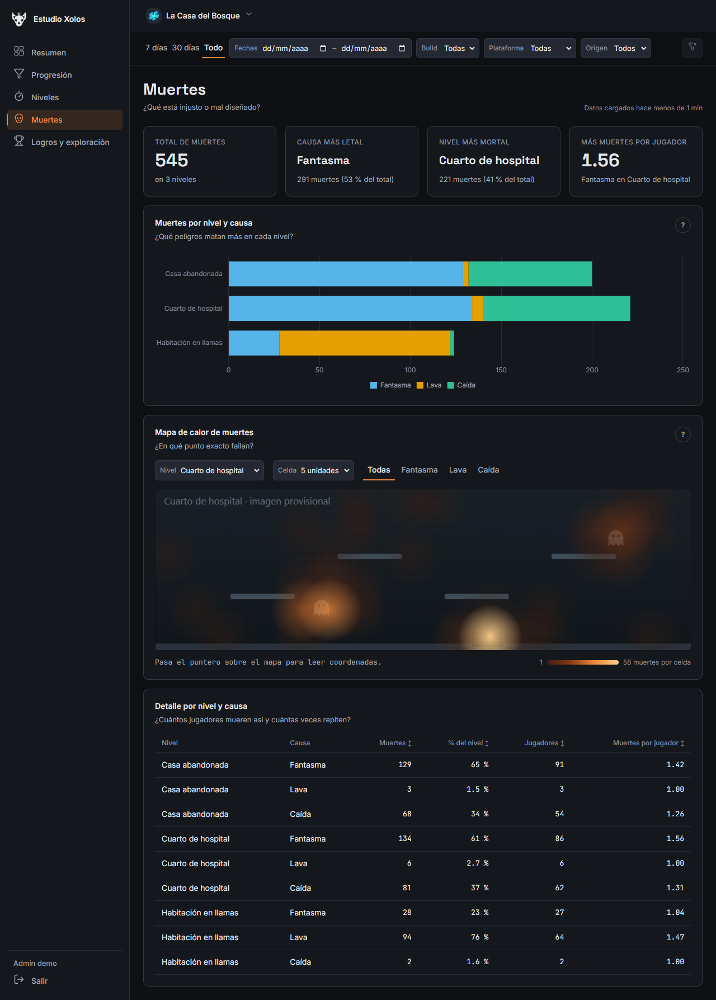
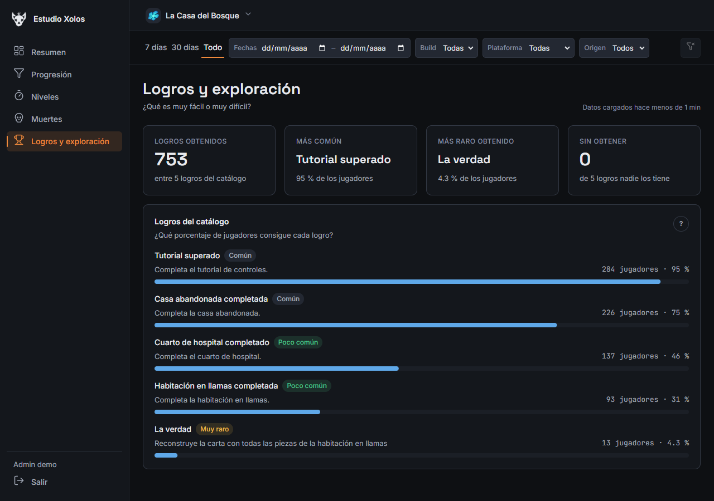
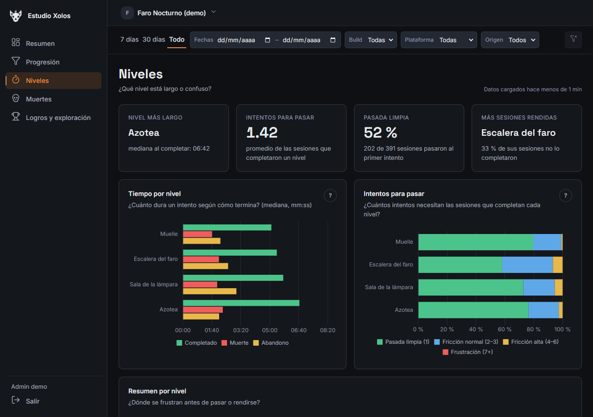

# Estudio Xolos Analytics

Plataforma de métricas **multi-juego** del estudio: cada juego (Unity) manda eventos a una API,
la API los valida y guarda en MongoDB, y un dashboard en Angular muestra estadísticas por juego
para decidir qué cambiar (¿qué nivel está largo?, ¿dónde se pierde la gente?, ¿qué mata más?).

El primer juego es **La Casa del Bosque** (plataformero narrativo de ~20 min, 3 niveles). El
seed incluye un segundo juego ficticio, **Faro Nocturno (demo)**, con otro catálogo (4 niveles,
otras causas y logros) para demostrar que el dashboard funciona con cualquier juego sin cambiar
código.

> Entrega 1 del curso de Sistemas Propietarios: API + MongoDB + dashboard + colección de
> Postman. El nombre del estudio sale de la variable `APP_NAME`.



## Contenido

- [Arquitectura](#arquitectura)
- [Estructura del repositorio](#estructura-del-repositorio)
- [Correr todo en local](#correr-todo-en-local)
- [Variables de entorno](#variables-de-entorno)
- [Crear juegos y admins](#crear-juegos-y-admins)
- [Pruebas: tests, lint y Newman](#pruebas-tests-lint-y-newman)
- [URLs públicas](#urls-públicas)
- [Prueba de carga](#prueba-de-carga)
- [Limitaciones conocidas](#limitaciones-conocidas)
- [Seguridad y dependencias](#seguridad-y-dependencias)
- [Capturas del dashboard](#capturas-del-dashboard)
- [Documentación](#documentación)

## Arquitectura



- **Ingesta:** cada juego tiene su API key (guardada como SHA-256). `POST /eventos` acepta lotes
  con aceptación parcial (`201 { aceptados, rechazados }`), idempotencia por `eventoId` y
  validación estricta contra el catálogo del juego.
- **Estadísticas:** se calculan al consultar con pipelines de agregación, filtradas por juego,
  fechas, build, plataforma y origen de los datos (reales o de prueba).
- **Dashboard:** login de admin con JWT; niveles, causas y logros salen del catálogo del juego
  (nada fijo en el frontend).

Decisiones, escalamiento ("Cómo crece") y lo que quedó fuera: [`docs/ARQUITECTURA.md`](docs/ARQUITECTURA.md).

## Estructura del repositorio

```
api/          API (Express 5 + Mongoose 9 + TypeScript estricto), tests (Jest + Supertest)
dashboard/    Dashboard (Angular 21, Chart.js, tests con Vitest)
postman/      Colección y entornos (local y producción) para Postman / Newman
sdk-unity/    Cliente C# de métricas para Unity (guía en docs/SDK_UNITY.md)
scripts/      Scripts de línea de comandos (crear admin y juegos, seed, prueba de carga…)
docs/         Esquema de eventos, decisiones, arquitectura, deploy, diseño, guion de demo
logos/        Logos originales y variantes de la marca
render.yaml   Configuración del servicio de la API en Render
```

## Correr todo en local

Requisitos: **Node 22.22** (ver `engines`), npm 10 y **MongoDB 7.0 o superior** (las
estadísticas usan `$median`): local (MongoDB Community o `docker run -d -p 27017:27017 mongo:7`)
o una base aparte en Atlas.

### 1. API

```bash
cd api
npm ci
cp .env.example .env        # y edita los valores (ver "Variables de entorno")
npm run dev                 # http://localhost:3000/api/v1 (se recarga al guardar)
```

Comprueba: `curl http://localhost:3000/api/v1/salud` → `{"estado":"ok"}`. La documentación
interactiva está en http://localhost:3000/api/v1/docs.

Para producción local: `npm run build && npm start`.

### 2. Base de datos: admin, juego y datos de prueba

Desde `/api` (los scripts leen el mismo `.env`; si la base no es local piden `--confirmar`):

```bash
npm run crear-admin                               # primer admin (ADMIN_EMAIL/PASSWORD/NOMBRE del .env)
npm run crear-juego -- --juego la-casa-del-bosque # muestra el juegoId y la API key UNA vez
npm run seed-datos                                # datos de prueba (origen "seed") de los 2 juegos
```

`seed-datos` crea "Faro Nocturno (demo)" si no existe y se puede repetir (borra su seed anterior).
Para quitar los datos de prueba: `npm run limpiar-seed`.

### 3. Dashboard

```bash
cd dashboard
npm ci
npm start                   # http://localhost:4200, contra la API LOCAL (localhost:3000)
```

Entra con el admin del paso 2. Para usar la API de producción desde tu computadora (sin guardar
credenciales en archivos): `npm run start:produccion` (requiere que `CORS_ORIGIN` de la API
incluya `http://localhost:4200`).

Para agregar dependencias al dashboard usa `npx npm@11 install <paquete>` (S-54).

### 4. SDK de Unity (opcional)

Guía completa en [`docs/SDK_UNITY.md`](docs/SDK_UNITY.md). Pruebas del núcleo fuera de Unity:
`cd sdk-unity && dotnet run --project Pruebas`.

## Variables de entorno

Viven en `api/.env` (local, ignorado por git) o en el panel de Render. **Nunca** en el
repositorio. Plantilla con comentarios: [`api/.env.example`](api/.env.example).

| Variable | Obligatoria | Para qué |
|---|---|---|
| `NODE_ENV` | no | `development`, `test` o `production` |
| `PORT` | no | Puerto HTTP de la API (Render lo define solo) |
| `APP_NAME` | no | Nombre del estudio (por defecto "Estudio Xolos") |
| `CORS_ORIGIN` | no | Orígenes del dashboard separados por coma, sin `/` final |
| `MONGODB_URI` | **sí** | Cadena de conexión, sin nombre de base en la ruta (**secreta**) |
| `MONGODB_DB` | **sí** | Base de datos (`xolos_analytics` en producción) |
| `JWT_SECRET` | **sí** (API) | Secreto de los JWT, mínimo 32 caracteres (**secreto**) |
| `TRUST_PROXY` | no | Saltos de proxy (Render = 1, local = 0) |
| `RATE_LIMIT_INGESTA_IP` | no | Peticiones de ingesta por minuto e IP (300) |
| `RATE_LIMIT_INGESTA_KEY` | no | Peticiones de ingesta por minuto y API key (1000) |
| `RATE_LIMIT_PUBLICO_IP` | no | `/salud` y `/docs` por minuto e IP (600) |
| `RATE_LIMIT_LOGIN_IP` | no | Logins fallidos por IP cada 15 min (5) |
| `ADMIN_EMAIL`, `ADMIN_PASSWORD`, `ADMIN_NOMBRE` | solo `crear-admin` | Primer admin; borra la contraseña del `.env` al terminar |

El dashboard no usa variables de entorno: la URL de la API está en
`dashboard/src/environments/` (`environment.development.ts` = local, `environment.ts` =
producción; es pública, no es un secreto).

## Crear juegos y admins

| Comando (desde `/api`) | Qué hace |
|---|---|
| `npm run crear-admin [-- --juegos slug1,slug2]` | Crea un admin (sin `--juegos`, con acceso a todos los juegos). No hay registro público. |
| `npm run crear-juego -- --juego <slug> [--version x.y.z]` | Crea un juego con su catálogo (`la-casa-del-bosque` o `faro-nocturno-demo`) y muestra la API key una sola vez. |
| `npm run rotar-api-key -- --juego <slug>` | Genera una key nueva; la anterior deja de servir al instante. |
| `npm run revocar-api-key -- --juego <slug>` | Revoca la key (el juego ya no puede mandar datos; sus datos se conservan). |
| `npm run seed-datos` / `npm run limpiar-seed` | Datos de prueba (`origen: "seed"`) y su borrado. |
| `npm run prueba-carga` | Prueba de carga contra una base aparte (ver abajo). |

Todos imprimen a qué base van a escribir, sin credenciales; si no es local piden `--confirmar`.
El detalle está en [`docs/ESQUEMA_EVENTOS.md`](docs/ESQUEMA_EVENTOS.md) §8.

## Pruebas: tests, lint y Newman

```bash
# API
cd api
npm test            # Jest + Supertest contra un MongoDB 7.0 en memoria
npm run lint
npm run typecheck

# Dashboard
cd dashboard
npm test            # Vitest
npm run lint
npm run build       # build de producción

# Postman / Newman contra la API local (con un juego creado con crear-juego).
# La contraseña se toma de una variable de la terminal para no dejarla en el historial.
cd api
npm run postman -- --env-var juegoId=<juegoId> --env-var apiKey=<apiKey> \
  --env-var adminEmail=<correo> --env-var adminPassword="$ADMIN_PASSWORD"

# Newman contra producción: solo la carpeta "Salud" (no crea datos)
npm run postman:produccion -- --env-var baseUrl=https://xolos-analytics-api.onrender.com/api/v1
```

La colección completa crea un jugador de prueba y al final lo borra. Las credenciales van en
variables de tu terminal o en el entorno de Postman de tu computadora, nunca en el repositorio.

## URLs públicas

| Qué | URL |
|---|---|
| API | https://xolos-analytics-api.onrender.com/api/v1 |
| Salud | https://xolos-analytics-api.onrender.com/api/v1/salud |
| Documentación (Swagger / OpenAPI) | https://xolos-analytics-api.onrender.com/api/v1/docs |
| Dashboard | https://sistemametricas-dashboard.vercel.app |

La API usa el plan gratuito de Render: después de un rato sin uso tarda ~1 minuto en
despertar. Antes de una demo, abre `/salud` unos minutos antes.

## Prueba de carga

Script: `npm run prueba-carga` ([`api/src/scripts/pruebaCarga.ts`](api/src/scripts/pruebaCarga.ts)).
Levanta la API en el mismo proceso contra una base **aparte** (`xolos_carga`, que se vacía al
empezar y se **borra al terminar**), crea un juego y un admin de prueba y la carga con
autocannon. Se niega a correr si `MONGODB_DB` es `xolos_analytics` (S-31).

```bash
cd api
# 1) Capacidad: límites por IP y por key subidos solo para esta corrida
MONGODB_URI=mongodb://localhost:27017 MONGODB_DB=xolos_carga \
RATE_LIMIT_INGESTA_IP=1000000 RATE_LIMIT_INGESTA_KEY=1000000 \
npm run prueba-carga -- --duracion 30 --conexiones 50 --lote 20

# 2) Límites normales (300/min por IP): comprobar el 429
MONGODB_URI=mongodb://localhost:27017 MONGODB_DB=xolos_carga \
npm run prueba-carga -- --duracion 30 --conexiones 50 --lote 20
```

**Condiciones:** AMD Ryzen 7 5700U (16 hilos), 15 GB de RAM, Windows 11 (10.0.26200);
Node v22.22.0; MongoDB 7.0.43 local (binario de `mongodb-memory-server`); API y autocannon en
el mismo equipo (sin latencia de red); 30 s por escenario, 50 conexiones, lotes de 20 eventos
por `POST /eventos`. Cada escenario de lectura corre justo después de su ingesta, sobre los
eventos que esta dejó.

**Corrida 1 — capacidad** (límites de ingesta 1 000 000/min por IP y por key; 69 120 eventos
guardados durante la ingesta):

| Escenario | Peticiones/s (promedio) | Latencia p50 | Latencia p99 | Peticiones | 2xx | 429 | Otros no 2xx | Errores | Timeouts |
|---|---:|---:|---:|---:|---:|---:|---:|---:|---:|
| Ingesta POST /eventos | 113.5 | 435 ms | 733 ms | 3406 | 3406 | 0 | 0 | 0 | 0 |
| Lectura GET /estadisticas/:id/embudo | 37.4 | 1342 ms | 1970 ms | 1121 | 1121 | 0 | 0 | 0 | 0 |

**Corrida 2 — límites normales** (300/min por IP, 1 000/min por key; 5 000 eventos guardados):

| Escenario | Peticiones/s (promedio) | Latencia p50 | Latencia p99 | Peticiones | 2xx | 429 | Otros no 2xx | Errores | Timeouts |
|---|---:|---:|---:|---:|---:|---:|---:|---:|---:|
| Ingesta POST /eventos | 755.4 | 51 ms | 679 ms | 22661 | 250 | 22411 | 0 | 0 | 0 |
| Lectura GET /estadisticas/:id/embudo | 221.1 | 222 ms | 347 ms | 6632 | 6632 | 0 | 0 | 0 | 0 |

**Lectura de los resultados:**

- Con límites altos, la ingesta sostuvo **113.5 lotes/s ≈ 2 270 eventos/s** sin errores ni
  timeouts, con p99 de 733 ms bajo 50 conexiones simultáneas.
- Con los límites normales, el rate limit funciona: de 22 661 peticiones, **250 se aceptaron**
  y el resto recibió **429**. Son 300 por minuto e IP menos las 50 aperturas de sesión
  (`POST /sesiones`), que cuentan contra el mismo límite. Las 429 son baratas (p50 de 51 ms).
- La lectura del embudo **se vuelve lenta con el volumen**: con 5 000 eventos, p50 de 222 ms;
  con 69 120, p50 de 1.3 s. El embudo se calcula al consultar recorriendo los eventos del
  juego. Para 10x–100x de volumen hay que precalcular (ver "Cómo crece" en
  [`docs/ARQUITECTURA.md`](docs/ARQUITECTURA.md)).
- **Alcance de estas cifras:** se midieron en una máquina de desarrollo con MongoDB local,
  con la API y autocannon en el mismo equipo (sin red de por medio). El plan gratuito de
  Render (CPU compartida) y Atlas M0 (cluster compartido, con latencia de red) darán menos.
  Por eso sirven como **referencia del comportamiento del código** (dónde está el cuello de
  botella, que el rate limit responde 429), **no como capacidad de producción**.

## Limitaciones conocidas

- **Fechas en días UTC (S-59):** los filtros de fecha y los atajos "7 días"/"30 días" usan días
  UTC, igual que la API. Para quien está en UTC-6, "hoy" cambia a las 18:00 hora local y un día
  filtrado va de 18:00 del día anterior a 17:59.
- **Lectura sin precálculo:** las estadísticas se calculan al consultar sobre los eventos
  crudos. Con decenas de miles de eventos y muchas consultas a la vez se vuelven lentas (en la
  prueba de carga, el embudo pasó de p50 222 ms a 1.3 s). El siguiente paso es precalcular
  resúmenes ([`docs/ARQUITECTURA.md`](docs/ARQUITECTURA.md), "Cómo crece").
- **Plan gratuito que duerme el servicio:** la API en Render se duerme sin uso y la primera
  petición tarda ~1 minuto. El dashboard avisa ("El servidor se está despertando") y el login
  muestra el estado de la API; antes de una demo hay que abrir `/salud` unos minutos antes.
- **Accesibilidad:** hay foco visible, navegación con teclado en tabs y controles, alternativa
  textual en las gráficas y contraste revisado con los tokens, pero **falta una pasada
  completa con lector de pantalla**.
- **Fuera de la entrega 1:** los endpoints `abandono`, `tutorial`, `atencion`, `versiones` y
  `rendimiento` (diseñados en `docs/ESQUEMA_EVENTOS.md` §10.8–10.12, responden 404); la pantalla
  "Builds y rendimiento"; la tabla de zonas calientes y el control de intensidad del mapa de
  calor; coleccionables encontrados vs disponibles; vista comparativa entre juegos; modo
  claro. El detalle y el porqué están en [`docs/ARQUITECTURA.md`](docs/ARQUITECTURA.md) §6.

## Seguridad y dependencias

- **Secretos:** solo en `api/.env` (local) y en el panel de Render. El `.gitignore` ignora
  `.env` y `.env.*` (menos `.env.example`), `node_modules/`, `dist/` y la configuración real
  del SDK (`xolos-metricas.json`, en cualquier carpeta); el ejemplo
  `sdk-unity/Configuracion/xolos-metricas.example.json` sí se versiona, sin valores.
- **`npm audit --omit=dev`** (dependencias que llegan a producción): **0 vulnerabilidades** en
  `api/` y en `dashboard/` (revisado el 2026-10-13).
- **Dependencias de desarrollo:** el dashboard tiene 0. En la API, las altas y la crítica vienen
  todas de **newman** (solo corre en local contra la colección propia) y hay moderadas de
  newman y de autocannon (prueba de carga, local). La "corrección" de npm baja newman a una
  versión mayor antigua, así que se dejan documentadas (S-65). Render instala y luego quita
  las dependencias de desarrollo (`npm prune --omit=dev`), así que no llegan a producción.
- **Dashboard:** CSP estricta (`script-src 'self'`, `connect-src` solo la API), HSTS,
  `X-Frame-Options: DENY` y demás cabeceras en `dashboard/vercel.json` (S-60).

## Capturas del dashboard

Con los datos del seed (semilla 42), verificadas con la misma CSP de producción.

| | |
|---|---|
|  |  |
| Login con el estado de la API | Lista de juegos (el demo sin logo usa su inicial) |
|  |  |
| Progresión: embudo e insignias | Niveles: tiempo por resultado e intentos |
|  |  |
| Muertes y mapa de calor | Logros con rareza |
|  | |
| El segundo juego (4 niveles) sin cambiar código | |

## Documentación

| Documento | Contenido |
|---|---|
| [`docs/ESQUEMA_EVENTOS.md`](docs/ESQUEMA_EVENTOS.md) | Contrato: eventos, catálogos, colecciones e índices, endpoints, errores, métricas |
| [`docs/ARQUITECTURA.md`](docs/ARQUITECTURA.md) | Diagrama, decisiones clave, cómo crece y qué quedó fuera |
| [`docs/DECISIONES_ABIERTAS.md`](docs/DECISIONES_ABIERTAS.md) | Decisiones abiertas, supuestos (S-xx) y resueltas (R-xx) |
| [`docs/DEPLOY.md`](docs/DEPLOY.md) | Render, Atlas, Vercel y CORS paso a paso |
| [`docs/DISENO_DASHBOARD.md`](docs/DISENO_DASHBOARD.md) | Fuente de verdad visual del dashboard |
| [`docs/SDK_UNITY.md`](docs/SDK_UNITY.md) | Integración del SDK en Unity |
| [`docs/GUION_DEMO.md`](docs/GUION_DEMO.md) | Guion de la demo |
