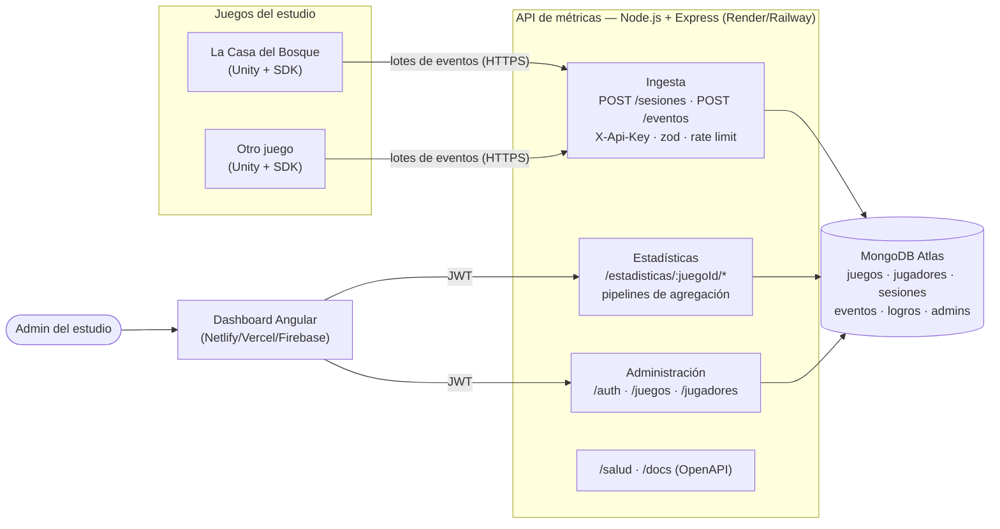

# Arquitectura

> **Estado:** diseño aprobado, aún sin código. Este documento explica cómo encajan las
> piezas, por qué se eligieron así y qué cambiaría si el volumen crece.
> El contrato detallado (eventos, colecciones, endpoints, consultas) está en
> [`ESQUEMA_EVENTOS.md`](./ESQUEMA_EVENTOS.md); los supuestos, en
> [`DECISIONES_ABIERTAS.md`](./DECISIONES_ABIERTAS.md).

---

## 1. Vista general

### Flujo de un dato

1. **Unity** arranca, pide un `sessionId` (`POST /sesiones`, con consentimiento) y acumula
   eventos en memoria.
2. Cada cierto tiempo, o al cambiar de nivel o cerrar, manda un **lote** (`POST /eventos`).
   Si falla la red, o llega un 429 o un 5xx, reintenta con espera creciente; los reenvíos son
   seguros por `eventoId`.
3. La **API** identifica el juego por la API key, valida cada evento con su esquema zod
   contra el catálogo del juego, guarda los válidos y responde
   `{ aceptados, rechazados }`.
4. El **dashboard** inicia sesión con JWT y pide estadísticas. La API las calcula con
   pipelines de agregación sobre `eventos` y `sesiones`, filtradas por juego, fechas,
   versión y plataforma.
5. El dashboard lee el **catálogo** del juego (niveles, logros, coleccionables) y dibuja las
   gráficas a partir de él: un juego nuevo aparece sin tocar el frontend.

---

## 2. Decisiones clave

| Decisión | Por qué | Qué habilita a futuro |
|---|---|---|
| **Multi-juego desde el día 1:** todo documento lleva `juegoId`; catálogo por juego en la BD | Agregar un juego es crear un documento, no programar | Clave natural para particionar (sharding) por juego; el seed demuestra un segundo juego |
| **API key por juego, guardada como SHA-256** | Revocar o rotar un juego sin afectar a otros; búsqueda por índice | Varios builds o estudios con keys independientes |
| **Jugador anónimo (UUID del cliente) + consentimiento** | Cero datos personales; cumple privacidad sin login | `cuentaId` reservado para vincular la cuenta del foro (entrega 3) |
| **Ingesta por lotes con aceptación parcial** | Menos peticiones desde Unity; un evento malo no tira el lote | Base para una cola de ingesta (ver "Cómo crece") |
| **`eventoId` + índice único** (idempotencia) | Reintentar es seguro: los duplicados se ignoran | Entrega "al menos una vez" con colas sin duplicar datos |
| **`secuencia` por sesión** | Orden exacto aunque coincidan los `timestamp` | Reconstrucción fiable de sesiones (abandono, embudos finos) |
| **Validación con zod, esquema por tipo** | Rechazo estricto de lo desconocido; tipos de TypeScript y OpenAPI salen del mismo esquema | Documentación que no se desincroniza del código |
| **`versionEsquema` en cada evento** | El formato puede cambiar sin romper builds viejos de Unity | Convivencia de versiones del SDK |
| **Rutas versionadas `/api/v1`** | Cambios incompatibles van a `/v2` sin romper `/v1` | Evolución de la API con juegos ya publicados |
| **Estadísticas calculadas al consultar (agregaciones)** | Simple y siempre al día con el volumen actual | Se pueden precalcular (ver "Cómo crece") sin cambiar el contrato de los endpoints |
| **API sin estado** (JWT, sin sesiones en memoria) | Cualquier instancia atiende cualquier petición | Escalar horizontalmente agregando instancias |
| **Una sola BD, colecciones por recurso** | Lo pide `CLAUDE.md`; consultas e índices simples | — |

---

## 3. Volumen de referencia (1x)

Supuestos para dimensionar (S-30):

| Dato | Valor 1x |
|---|---|
| Jugadores por día | ~100 |
| Sesiones por jugador | ~1 (juego lineal de ~20 min) |
| Eventos por sesión | ~150 |
| Eventos por lote | ~20 → ~8 peticiones por sesión |
| Tamaño medio de un evento en BD (con índices) | ~0.5 KB |
| **Eventos por día** | **~15 000** (~7.5 MB/día) |
| Pico de ingesta | unas pocas peticiones/segundo |

A 1x todo cabe en el plan gratuito: una instancia de API y Atlas M0 (512 MB, unos 2 meses
de eventos a este ritmo).

---

## 4. Cómo crece

### 10x (~1 000 jugadores/día, ~150 000 eventos/día, ~75 MB/día)

| Dónde duele | Qué cambia |
|---|---|
| **Almacenamiento:** M0 se llena en ~1 semana | Subir a Atlas M10 o superior. Política de retención: eventos crudos N días (índice TTL o archivado), agregados para siempre. |
| **Dashboard lento:** las agregaciones recorren todos los eventos crudos | **Precálculo:** un job periódico (cada hora o noche) resume por juego/día/nivel/versión con `$merge` en colecciones de resumen (`resumenes_diarios`). Los endpoints de estadísticas leen el resumen y solo agregan en crudo el día en curso. El contrato de los endpoints no cambia. |
| **Consultas repetidas** | Caché corta (1–5 min) de respuestas de `/estadisticas/*` por juego y filtros. |
| **Rate limit en memoria** | Si hay más de una instancia, cada una cuenta por separado. Pasar el contador a un almacén compartido (Redis) con el store de `express-rate-limit`. |
| **Índices** | Revisar con `explain()` las consultas reales y ajustar índices compuestos. |

### 100x (~10 000 jugadores/día, ~1.5 M eventos/día, ~750 MB/día, ~22 GB/mes)

| Dónde duele | Qué cambia |
|---|---|
| **Escrituras en picos** (un lanzamiento, un streamer) | **Cola de ingesta:** la API valida y publica el lote en una cola (por ejemplo Redis Streams, SQS o Kafka) y responde enseguida; workers insertan con `insertMany` sin orden. La idempotencia por `eventoId` hace segura la entrega "al menos una vez". |
| **Una sola instancia de API** | Varias instancias detrás de un balanceador (la API ya no tiene estado). Autoescalado por CPU o por longitud de la cola. |
| **Volumen de `eventos`** | Colección **time series** de MongoDB o **sharding** con clave `{ juegoId, timestamp }` (el `juegoId` ya está en todo). Archivar eventos crudos viejos a almacenamiento frío (S3/Parquet) para análisis offline. |
| **Lecturas del dashboard compiten con escrituras** | Leer estadísticas desde réplicas secundarias (`readPreference: secondaryPreferred`); los resúmenes precalculados ya absorben casi todo. |
| **Juegos nuevos con tipos de evento nuevos** | Hoy un tipo nuevo requiere código (su esquema zod). A esta escala, los **esquemas del `data` pasan al catálogo** (JSON Schema por tipo, versionado) y la API los valida dinámicamente: un estudio agrega un juego y sus eventos sin desplegar la API (S-28). |
| **Eventos de alto volumen y poco valor** (`rendimiento`) | Muestreo en el SDK (por ejemplo 10 % de las sesiones), configurable desde el catálogo. |
| **Observabilidad** | Métricas de la propia API (latencia, tasa de rechazo, tamaño de cola) y alertas. |

### Qué ya está preparado y qué no

- **Preparado desde la entrega 1:** `juegoId` en todo (clave de partición), `eventoId`
  (idempotencia para colas), lotes, API sin estado, rutas versionadas, `versionEsquema`,
  catálogo en BD, endpoints de estadísticas con contrato estable (se puede cambiar el
  cálculo por dentro sin tocar el dashboard).
- **No se hace en la entrega 1** (no hace falta a 1x y agregaría complejidad): cola,
  Redis, precálculo, sharding, esquemas dinámicos. Quedan como el camino natural de
  crecimiento descrito arriba.

---

## 5. Evidencia

- **Prueba de carga:** `scripts/` contiene una prueba con autocannon contra la ingesta.
  Los resultados (peticiones/s, latencias p50/p99, errores) y las condiciones en que se
  midió están en el README (S-31). Corre contra un MongoDB local o una base aparte
  que se borra al terminar, nunca contra `xolos_analytics`.
- **Multi-juego:** `seed-datos` crea La Casa del Bosque y un segundo juego ficticio con
  catálogo distinto; el dashboard muestra los dos sin cambios de código.
- **Contrato verificable:** OpenAPI en `/api/v1/docs`, generado desde los mismos esquemas
  que validan las peticiones.
